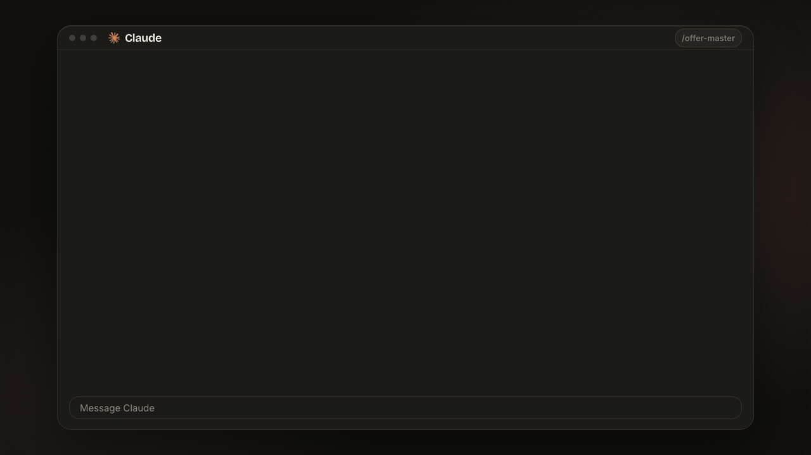

<p align="center">
  
</p>

# Offer Master

A Claude skill that fixes an offer that isn't selling.

People see the page. Almost nobody buys. The product is usually fine. The offer is what you change.

It finds where buyers drop off, reads what their objections actually mean, and hands back the exact words for the page. Every number is labelled as yours or an estimate.

<p align="center">
  
</p>

The clip is an example. The offer in it is a made-up fitness coach, the same kind of test the skill was judged on. It is a test, and the skill will refuse a refund tied to getting stronger. That line in the picture is an earlier draft.

## Eight skills

`/offer-master` runs the whole fix and uses the other seven. Each one also works on its own.

| Command | What it does |
|---|---|
| `/offer-master` | The whole fix, end to end |
| `/offer-diagnosis` | Where buyers drop off, whether it really is the offer, what the objections mean |
| `/offer-levers` | Scores Result, Belief, Speed and Ease, and picks what to fix first |
| `/offer-included` | The one-line promise, the first-week win, what's included, what to cut, bonuses that kill a doubt |
| `/offer-guarantee` | One fair capped guarantee, and what it costs if people claim it |
| `/offer-urgency-name-price` | A real deadline, the cost of waiting, a name people would text, the price |
| `/offer-honesty-check` | Made-up numbers, fake scarcity, promises you can't back |
| `/offer-card` | The finished offer, ready to paste |

## Install

**The one step:** paste this into Claude Code:

```
https://github.com/Liamrjohnston/offer-master-skill.git
Clone this and add the skills.
```

Claude clones the repo and adds the eight skills to your skills folder.

**Or do it yourself:**

```bash
git clone https://github.com/Liamrjohnston/offer-master-skill.git
cd offer-master-skill
bash install.sh
```

That copies all eight folders into `~/.claude/skills/`. Start a new Claude Code session afterwards so it picks them up.

> **Note for Claude:** to install these skills, copy every folder under `skills/` that contains a `SKILL.md` into `~/.claude/skills/` (create that folder if needed). There are eight: `offer-master`, `offer-diagnosis`, `offer-levers`, `offer-included`, `offer-guarantee`, `offer-urgency-name-price`, `offer-honesty-check`, `offer-card`. Don't overwrite an existing folder without asking. Then tell the user to start a new session and type `/offer-master`.

## Use it

Type `/offer-master` and describe the offer in plain words:

```
/offer-master 400 people see my sales page each month. 1 buys. Fix my offer.
```

Give it what you have: what you sell, the price, who it's for, rough numbers (visitors, calls, sales), what buyers say when they don't buy, and any real results you can prove. It asks for anything important that's missing before it rebuilds anything.

You get back a short offer card: the name, promise, first win, what's included, the guarantee, why now and the price. Every number is labelled as yours or an estimate. It also gives you one test to run this month.

## The 12 rules

| Rule | Skill |
|---|---|
| Is it the offer? | `offer-diagnosis` |
| Decode the objections | `offer-diagnosis` |
| Score 4 levers | `offer-levers` |
| Say it in one line | `offer-included` |
| Lead with proof | `offer-included` |
| Win in week one | `offer-included` |
| Cut the extras | `offer-included` |
| Bonuses kill doubts | `offer-included` |
| One fair guarantee | `offer-guarantee` |
| Real deadlines | `offer-urgency-name-price` |
| A name you'd text | `offer-urgency-name-price` |
| Cost of waiting | `offer-urgency-name-price` |

## What it will not do

It will not invent client results, fake scarcity, fake deadlines, fake bonus values, or promises you can't keep. A missing number stays a placeholder. If something needs checking, it lists it under "Check these".

A guarantee answers the fear with work the owner controls. It will not refund the fee because a weight, a booking count or an income number didn't happen.

## Why this one

Written from scratch after reading 18 public offer skills in full. The ones it learned from are in [CREDITS](skills/offer-master/CREDITS.md).

Blind test, three made-up businesses, three runs each. Judged against the most installed public offer skill, plain Claude, and a one-line prompt. The judge could not see which answer was which. This version won all 9. Overall score was 8 out of 10 on every case, the same as the previous single skill. Honesty stayed at 9 or above on every case. The previous version's judged run was 9, 7 and 9.

## What a run looks like

A test, not a client. A web designer charges $3,500 for a 5-page site. About 6 people enquire each month, then go quiet. They say "more than I expected" and "my nephew could do it". One real result: Brightside Physio went from 4 to 19 online bookings a month in 60 days. Seven sites built. Two sites a month.

One run came back with this promise and this guarantee. Another run will word it differently. The labels stay.

> A site built so visits become booked appointments. Brightside Physio went from 4 to 19 online bookings a month in the first 60 days. Yours is live in 3 weeks, button tested.

> Update your Google profile and send the booking link to current customers. Use the site for 60 days. If online bookings still aren't coming through, we rework the page and listing, up to 6 hours, at no cost. This is not a promise of a booking count, and it is not a refund.

Price on that card: $3,500, or $1,750 to start and $1,750 when it is live. The $3,500 is the owner's number. The split is labelled an estimate.

## License

MIT. See [LICENSE](LICENSE).
